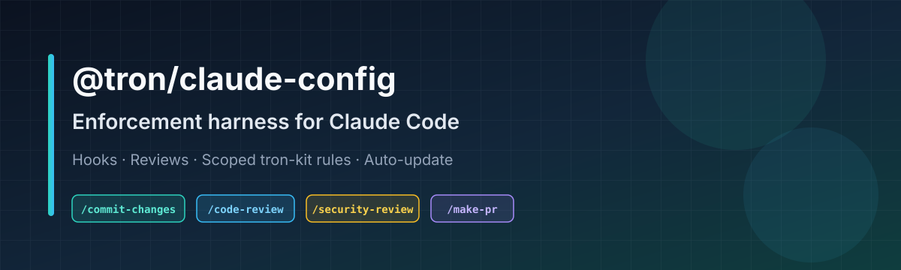
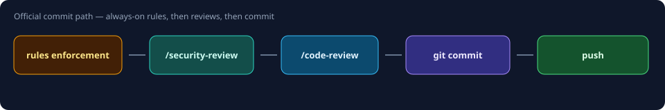

<p align="center">
  
</p>

<p align="center">
  <strong>Stop hoping the AI follows the process. Make the process impossible to skip.</strong>
</p>

<p align="center">
  
  
  
  
</p>

---

# @tron/claude-config

**One dev dependency turns Claude Code and Cursor into a disciplined engineering team.**

Add it to any repo and `npm install` does the rest: reviewed-only commits, complete PRs, coding rules matched to your stack, a 12-agent roster with fixed model tiers, a lean technical skill library for 20+ stacks, a design system for every UI task, and structural code navigation — all enforced by hooks and the filesystem, not by the model's memory.

> **Hooks over vibes.** Reviews before every commit. Complete PRs before every merge. Rules that match the project. Silent daily self-update. Clean upgrades.

---

## Why teams install it

| Without the harness | With the harness |
|---------------------|------------------|
| Anyone — or any model — can `git commit` raw | Commits only through `/commit-changes`, **after a security review and a code review** |
| PRs that say "fix stuff" | Every PR body follows a **5-section template**, checked before `gh pr create` runs |
| 80-file PRs nobody can review | **Max 25 changed files per PR** — bigger work is split into cohesive PRs |
| Paragraph-long comments that rot | **Comments only for business rules**, one terse line |
| Rules copied by hand, or forgotten | **Coding rules synced to the detected stack** (Vue, React, TypeScript, Python, Go, …) |
| 100+ overlapping agents, random model choices | **12 agents**, one per domain, with the model tier **fixed per phase** |
| Generic, inconsistent UI output | A **design authority** that loads on every UI task, with a hook-enforced detector |
| The agent reads the whole codebase to answer one question | **Graph-first navigation** through the `tron-graph` MCP, live docs through `tron-docs` |
| "Did you update the package?" | **Self-updates** once a day, silently, and reinstalls cleanly |
| A different process in every repo | **One kit** across the company |

<p align="center">
  
</p>

---

## 60-second install

**1. Add the dependency**

```json
{
  "devDependencies": {
    "@tron/claude-config": "git+https://github.com/zaqueu-1/tron-claude-config.git"
  }
}
```

**2. Install**

```bash
npm install   # or: pnpm install / bun install
```

That's it. `postinstall` wires the repo and, on developer machines, installs the global toolkit. CI runs only the repo-level part.

The harness lives under `.claude/` and `.git/hooks/`. It **never touches** your `CLAUDE.md`, repo-local `.claude/commands/` or `.claude/settings.local.json`.

---

## What you get

### 1. Gates you can't skip

| Command | What it guarantees |
|---------|--------------------|
| `/commit-changes` | The only commit path: security review → code review → one-shot token → commit → push |
| `/security-review` | Security checklist on the diff; **blocks** on critical/high findings |
| `/code-review` | Correctness and quality review on the diff; **blocks** on critical/high findings |
| `/make-pr` | The only PR path: fills the template, validates it, then opens the PR |

Raw `git commit` in a terminal is blocked by `pre-commit`, and direct pushes to `main`/`master` are blocked by `pre-push`. Agents refuse hook-skipping flags, so a failing hook gets fixed, not bypassed.

### 2. Twelve agents, one per domain

A single enforced roster for Claude Code and Cursor, replacing the 105 agents the bundled toolchains used to install.

| Agent | Area | Agent | Area |
|---|---|---|---|
| `tron-designer` | UX/UI & design | `tron-qa` | QA & code review |
| `tron-frontend` | Web frontend | `tron-security` | AppSec & compliance |
| `tron-backend` | Backend (default implementer) | `tron-pm` | Product & planning |
| `tron-mobile` | Native & cross-platform | `tron-cto` | Architecture & tech strategy |
| `tron-data-ai` | Data, LLM/ML, evals | `tron-researcher` | Research & docs |
| `tron-devops` | CI/CD & delivery | `tron-infra` | Cloud, IaC, networking |

- **Six pillars, in strict order:** security → architecture → model governance → quality → token economy → speed.
- **Model tier by phase:** planning, research, review and docs run on the economical tier; code execution runs on the robust tier. In Claude Code, per-call model overrides are rewritten back to the agent's tier.
- **Enforced, not suggested:** `agent-roster-guard.js` runs on every subagent spawn. Legacy agent names (`planner`, `code-reviewer`, …) are rewritten to their tron owner with the original contract attached, so workflow and design engines keep working; unknown agents are blocked. Agent files dropped by other tools are swept to `~/.claude/tron/agent-roles/`.

### 3. tron-kit — a lean technical library

The `tron-kit@tron` Claude Code plugin, written and owned by tron, installed at user scope:

- **21 stack skills**, each a short router that loads detailed references only when needed: `tron-web`, `tron-react`, `tron-vue`, `tron-angular`, `tron-services`, `tron-python`, `tron-java`, `tron-kotlin`, `tron-go`, `tron-rust`, `tron-cpp`, `tron-dotnet`, `tron-php`, `tron-swift`, `tron-flutter`, `tron-react-native`, `tron-databases`, `tron-ml`, `tron-quality`, `tron-delivery`, `tron-research`.
- **3 commands:** `build-fix`, `test-coverage`, `refactor-clean`.
- **Quality hooks:** a config guard (no weakening linter/formatter configs to make errors go away), a hook-bypass guard, and on stop: format, type check and a `console.log` check on the files that were edited.
- **Language rules** for 22 stacks, synced into each repo by scope (see below).

### 4. A design authority for every UI task

1. **tron design stack** — the source of truth for design. `tron-design` always loads first: modes (persuade, operate, read, experience), direction, critique and audit, refine commands (`polish`, `harden`, `typeset`, `layout`, …), live browser iteration, style modules and a hook-enforced design detector. `tron-motion` covers animation and interaction feel (web and Expo), `tron-native` covers native platform craft and Swift/SwiftUI, and `tron-imagery` covers image-model comps, image-to-code and brand kits.
2. **tron-design-fallback** — subordinate, consulted only after the stack sets direction, for charts and data visualization, form UX, web navigation and stack implementation guidelines.

On any conflict the stack wins. The design engine runs with telemetry and self-update turned off. Edit-discipline hooks are merged into the repo's `.cursor/hooks.json` and `.github/hooks/tron-design.json` without dropping existing hooks.

### 5. Code intelligence

- **`tron-graph` MCP** — a structural code graph (search, call paths, architecture, snippets) so agents query structure before reading files. Registered for Claude Code and Cursor on macOS, Linux and Windows, with retries and an npm fallback.
- **`tron-docs` MCP** — current library and API documentation, so answers don't rely on stale training data.

### 6. Workflow skills

| Skill | What it does |
|-------|--------------|
| `/session-handoff` | Saves the session as an actionable note in a central Obsidian vault for an agent that never saw the conversation, and resumes from the latest note. Collected git/PR state beats conversation memory; secrets are redacted; authorizations never carry over. |
| `/issue-board` | Shows your open issues from any GitHub Project (v2) as terminal tables, grouped by type, priority, difficulty, status, repo or any board field. The agent classifies only what the board leaves empty, and board values always win. |
| `/doc` | Finds the repo's Obsidian documentation vault, flags notes whose `file:line` references broke or point to changed code, and applies only the changes you approve. Never commits. |

These skills were written for a Portuguese-speaking team, so their trigger phrases are Portuguese (for example "resume a sessão", "minhas issues", "atualiza a doc"); calling them by name works in any language. Each keeps personal settings in a local `config.json` that upgrades never overwrite. Full usage: [HARNESS-GUIDE.md](HARNESS-GUIDE.md).

### 7. Always-on behavior rules

- **Engineering principles** — clarify, make the smallest change, touch only what's needed, prove it's done.
- **Terse mode** — fewer output tokens, same substance; code comments are terse too, while commits and PRs stay in normal prose.
- **Harness enforcement and agent isolation** — the contract every agent follows inside the harness.

---

## How enforcement works

### Commit path

1. `/security-review` on the diff → **blocks** on critical/high
2. `/code-review` on the same diff → **blocks** on critical/high
3. Creates the one-shot token `.claude/.commit-authorized`
4. `git commit` — the hook allows it once and deletes the token

### PR path

1. `/make-pr` checks the branch size: over **25 changed files**, it proposes splitting the work into smaller PRs, each with one cohesive goal (stacked when dependent)
2. Writes `.claude/.pr-body-draft.md` from `.claude/PR-TEMPLATE.md` and validates it with `node .claude/hooks/lib/validate-pr-body.cjs`
3. `gh pr create --body-file .claude/.pr-body-draft.md` — the hook checks only two things: the five template titles appear in the body, and the PR has at most 25 changed files

The five titles are in Portuguese: **Resumo** (summary), **Principais mudanças** (key changes), **Arquitetura & implementação** (architecture & implementation), **Antes → Agora** (before → after) and **Roteiro de teste** (test plan). A section that doesn't apply keeps its title with an N/A line.

### Code comments

A rule every agent follows: no comment unless it states a relevant business rule, and then a single terse line. Any comment longer than 2 lines in a file being edited is cut down to one terse line in the same change.

### Scoped rules

On install and on every harness update, the package detects the stack from `package.json` and project markers, then syncs only the matching rule folders from the bundled tron-kit into `.claude/rules/tron/` (no network). Folders that no longer match are removed. `common` is always included; `typescript`, `vue`, `nuxt`, `react`, `react-native`, `web`, `python`, `golang`, `csharp` and the other tron-kit languages are added when detected.

### Session bootstrap

Every Claude prompt runs `bootstrap-check.sh`, which re-ensures `tron-graph` if it is missing, warns if the workflow engine is missing, and once every 24 hours compares the installed package to the remote and self-updates. Manual repair: `npm run ensure:tron-graph`.

### Quality layers

| Layer | Where | Decides |
|-------|-------|---------|
| tron-kit rules | `.claude/rules/tron/` | Coding standards |
| Engineering principles | `~/.claude/rules/engineering-principles.md` | How to approach the work |
| Harness commands | `~/.claude/commands/` | The commit and PR workflow |

---

## Clean upgrades

Every update — `npm install` or the daily self-update — reinstalls the harness from scratch, so nothing from an older version lingers:

- **Directory trees are replaced wholesale:** tron-kit, the design stack, tron-design-fallback and the scoped rules folders.
- **Single files are tracked:** every command, rule and skill file written under your home directory is recorded with its hash in `~/.claude/tron/installed.json`. When a release stops shipping a file, the next install deletes it. If you edited it, it's kept and reported instead.
- **Your edits are never lost:** if `/commit-changes`, `/code-review` or `/security-review` differ from what the package last installed, the old file is saved as `<name>.md.bak` before syncing.
- **Retired pieces are cleaned up:** legacy plugins, superseded design skills, retired rules and old consumer hook files are removed automatically.
- **Personal data is untouched:** `config.json` and `data/` in workflow skills, your `CLAUDE.md`, local settings and repo-local commands.

---

## What lands where

**In every consumer repo**

```
your-project/
├── .claude/
│   ├── settings.json           ← Claude Code hooks
│   ├── PR-TEMPLATE.md          ← PR body scaffold
│   ├── rules/tron/             ← tron-kit rules (common + stack-matched folders)
│   ├── .tron-scope.json        ← last detected scope (audit trail)
│   └── hooks/
│       ├── bypass-check.sh     ← commit token + PR titles/size gate
│       ├── bootstrap-check.sh  ← tool check + daily self-update
│       └── lib/*.cjs           ← PR body and command validators
├── .git/hooks/
│   ├── pre-commit              ← blocks raw commits
│   └── pre-push                ← blocks raw pushes to main/master
├── AGENTS.md                   ← agent contract for this repo
└── scripts/setup-claude-harness.sh
```

**On the developer machine:** the four gate commands in `~/.claude/commands/`; behavior rules in `~/.claude/rules/`; the 12 agents in `~/.claude/agents/` and `~/.cursor/agents/`; the tron-kit plugin; the design stack in `~/.agents/skills/` (symlinked into `~/.claude/skills/`, `~/.cursor/skills/` and `~/.github/skills/`); the workflow skills in `~/.claude/skills/`; the `tron-graph` and `tron-docs` MCPs; and the workflow engine with its `standard` profile (discuss → plan → execute → verify).

---

## Emergency bypass (humans only)

Agents never skip hooks: a failing hook gets fixed, or the agent stops and asks. If a person truly has to ship past a broken gate, they do it themselves in their own terminal and fix the gate in a follow-up. Removing the harness from a repo means removing the dependency and its git hooks, not editing them away.

---

## Releasing

Push to `main`. Consumers pick up the change on the next daily check, or immediately on `npm install`.

```bash
npm version patch|minor|major
git push origin main --follow-tags
```

Maintainer playbook: **[MAINTAINER.md](MAINTAINER.md)** · Day-to-day reference: **[HARNESS-GUIDE.md](HARNESS-GUIDE.md)**

---

## Uninstall

```bash
rm .git/hooks/pre-commit .git/hooks/pre-push
npm uninstall @tron/claude-config
# optional: rm .claude/hooks/bypass-check.sh .claude/hooks/bootstrap-check.sh
```

---

## Package map

```
tron-claude-config/
├── package.json                  # v1.15.3 · postinstall entry
├── scripts/
│   ├── postinstall.js            # install orchestrator + home-file ledger
│   ├── sync-tron-rules.js        # manual rules re-sync CLI
│   └── lib/
│       ├── detect-project-scope.js
│       ├── install-tron-rules.js
│       ├── install-tron-kit.js   # user-scope plugin install + legacy cleanup
│       ├── install-tron-agents.js# 12 agents + roster guard hooks
│       ├── ensure-tron-graph.js  # code graph MCP (Windows + macOS/Linux)
│       └── ensure-tron-docs.js   # docs MCP registration
├── managed/
│   ├── AGENTS.md
│   ├── setup-claude-harness.sh
│   ├── tron-kit/                 # plugin: stack skills, commands, hooks, rules
│   ├── agents/                   # 12 tron agents, roster.json, roster guard
│   ├── claude/                   # settings, hooks, PR template, global rules
│   ├── cursor/rules/             # frontend-skills.mdc (design authority order)
│   ├── git-hooks/                # pre-commit, pre-push
│   ├── hooks/                    # Cursor + GitHub tron-design hook templates
│   └── skills/                   # gate commands, workflow skills, design stack
├── upstream/                     # maintainer-only, not published (see MAINTAINER.md)
├── docs/assets/                  # README visuals
├── HARNESS-GUIDE.md
├── MAINTAINER.md
└── README.md
```

---

<p align="center">
  <em>One install. Company-wide process. Reviews you can't skip.</em>
</p>
