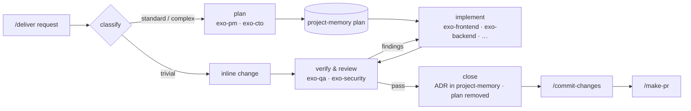

<p align="center">
  
</p>

# Exonous

**A second brain for coding agents.** Exonous gives Claude Code and Cursor the rules, workflow, memory and checks that every repository of a team should share. Hooks enforce them; nobody has to remember them.

> *Exonous*, from Greek ἔξω (*exo*, "outside") + νοῦς (*nous*, "mind"): the mind outside your head.

Coding agents reason brilliantly and forget everything. Each session they re-discover the codebase, re-read whole files to use ten lines, skip the review the team agreed on, and lose the decision made last week. Exonous fixes the parts that instructions alone never fix:

- **Gates you cannot skip.** Commits pass a security review and a code review; PRs follow a template and a size cap. Git hooks and Claude Code hooks enforce it, not goodwill.
- **A workflow sized to the work.** Trivial changes stay inline; real features go plan → build → verify → review with a fixed roster of agents and compact reports.
- **Memory that does not rot.** Decisions, plans and explanations live in your Obsidian vault, anchored to the exact lines of code they describe, with drift detection.
- **A small, constant context bill.** One always-on rule under 4.5 KB, locate-first code navigation, and nudges away from whole-file reads.

---

## What's inside

Skills and commands have plain English names for what they do. The always-on pieces underneath (the rule, the MCP servers, the hooks and the techne plugin) keep short Greek names.

| Name | Greek | What it does | How you use it |
|---|---|---|---|
| **nomos** | νόμος, law | The single always-on rule: priorities, terse replies, engineering discipline, verification, git gates, the agent roster | Loaded automatically in every session |
| **deliver** | — | Delivery workflow: classify → plan → execute → verify → close | `/deliver <request>` · `/deliver plan …` · `/deliver resume <id>` · `/deliver status` |
| **project-memory** | — | ADRs, plans and docs in your vault, anchored to code, searched offline, with drift checks | Through deliver and session-handoff, or directly: `node ~/.claude/skills/project-memory/project-memory.mjs search "…"` |
| **commit-changes** | — | The only way to commit: leak scan, security review, code review, then a one-shot token | `/commit-changes` |
| **make-pr** | — | The only way to open a PR: template body, ≤ 25 changed files (pure renames don't count) | `/make-pr` |
| **code-review** | — | Code review of local changes or a PR | `/code-review [PR]` |
| **security-review** | — | Security review: secrets, injection, auth, XSS, data exposure | `/security-review` |
| **session-handoff** | — | Session handoff notes in the vault, and resuming from them | `/session-handoff` |
| **doc** | — | Finds which vault docs a session made stale and updates them | `/doc` |
| **issue-board** | — | Your open issues from GitHub Projects, ranked and grouped | `/issue-board` |
| **atlas** | Ἄτλας, the map | Structural code graph (MCP): search symbols, trace calls, fetch exact snippets | `mcp__atlas__*` tools |
| **biblos** | βίβλος, book | Live library and API documentation (MCP) | `mcp__biblos__*` tools |
| **techne** | τέχνη, craft | Stack skills (Vue, React, Go, Python, …), language rules scoped to your stack, quality hooks | `techne:<stack>` skills, loaded on demand |
| **ui-design** | — | Design direction, critique, audit and polish for any UI work | `/ui-design <command>` |
| **ui-motion** | — | Animation and interaction feel, web and Expo | loaded with ui-design |
| **native-ui** | — | Native platform feel: Apple HIG, SwiftUI, React Native | loaded with ui-design |
| **ui-mockup** | — | Comps, mockups and image-to-code | loaded with ui-design |
| **ui-patterns** | — | Charts, forms, navigation and stack guidelines, subordinate to ui-design | loaded after ui-design sets direction |
| **taxis** | τάξις, order | Hook that allows only the 12 `exo-*` agents, remaps the rest and pins each agent's model tier | automatic |
| **pyle** | πύλη, gate | Hook that blocks `git commit` without the commit-changes token and non-conforming `gh pr create` | automatic |
| **metron** | μέτρον, measure | Hook that nudges whole-file reads of large files toward locate-first | automatic |
| **kairos** | καιρός, the right moment | Session hook: workspace map, update notes, background updates | automatic |

### The agents

Twelve subagents, each fixed to a model tier: planning, review and research run on the economical tier; code is written on the robust one.

| Agent | Role | Agent | Role |
|---|---|---|---|
| `exo-pm` | requirements, plans, backlog | `exo-backend` | APIs, domain logic, the default implementer |
| `exo-cto` | architecture, ADRs, tech choices | `exo-mobile` | React Native, Swift, Kotlin, Flutter |
| `exo-researcher` | code navigation, docs, research | `exo-data-ai` | schema, queries, pipelines, LLM features |
| `exo-designer` | UX direction, accessibility, design review | `exo-devops` | CI/CD, releases, git hooks |
| `exo-frontend` | web UI (Vue/Nuxt, React/Next, Tailwind) | `exo-infra` | cloud, IaC, Kubernetes, observability |
| `exo-qa` | review, tests, verification gate | `exo-security` | AppSec, auth, secrets, dependencies |

Every agent report starts with one JSON line, `{"status":"done|partial|blocked","cause":"…","risks":[…]}`, so the coordinating session reads results instead of transcripts.

---

## Install

Add Exonous as a dev dependency and install with whatever package manager the repo already uses:

```jsonc
// package.json
{
  "devDependencies": {
    "exonous": "github:zaqueu-1/exonous"
  }
}
```

```bash
npm install        # or: pnpm install / bun install
```

That's all. `postinstall` runs `exonous setup`:

- **In the repository:** `AGENTS.md`, `.claude/settings.json`, the pyle/metron/kairos hooks, the PR template, `pre-commit` and `pre-push` git hooks, and the techne rules for the stacks it detects.
- **On developer machines:** nomos, the agents, the skills, the design stack, the techne plugin, and the atlas and biblos MCP servers. CI gets only the repository part.

Setup never overwrites your `CLAUDE.md`, `.claude/commands/` or `.claude/settings.local.json`.

Then point project-memory at your Obsidian vault once per machine:

```bash
echo '{ "vault": "/absolute/path/to/your/vault" }' > ~/.claude/skills/project-memory/config.json
```

Memories live in `<vault>/<repo-name>/memory/{adr,plan,doc}/` as plain Markdown with frontmatter, readable and editable in Obsidian.

---

## A day with Exonous



1. **Start a task:** `/deliver add rate limiting to the public API`. It looks up related decisions with project-memory, classifies the work and states the branch strategy. Trivial work is done inline. Larger work gets a plan, saved as a project-memory `plan` so it survives the session.
2. **Build and verify:** implementers get a compact packet (goal, files, done-checks), and gate agents fetch the diff themselves. Revision rounds go back to the same agent, and the loop stops after two rounds without progress.
3. **Close:** decisions become ADRs anchored to code, and the executed plan is removed.
4. **Ship:** `/commit-changes` runs `/security-review` and `/code-review`, then commits. `/make-pr` opens the PR from the template.
5. **Stop for the day:** `/session-handoff` writes a handoff note to the vault; `/session-handoff resume` picks it up tomorrow.

---

## Updates

Updates are automatic and silent:

- Once a day, kairos runs `exonous update` in the background at session start, so it never delays you.
- It moves the dependency to the newest `vX.Y.Z` release tag, reinstalls with your package manager and re-runs setup.
- Files a release dropped are removed from every machine, except ones you edited.
- The next session shows one line: `exonous updated v2.0.0 → v2.1.0`.

```bash
npx exonous update            # update now
npx exonous update --check    # just tell me
```

To freeze a repo, pin the dependency to a commit or branch (`github:zaqueu-1/exonous#<sha>`); pinned specs are never touched. Set `EXONOUS_NO_UPDATE=1` to skip the daily check.

## Doctor and uninstall

```bash
npx exonous doctor      # every piece, ✓ or ✗ with the exact fix
npx exonous uninstall   # removes what setup wrote; keeps MCP registrations and your skill config
```

## Migrating from `@tron/claude-config`

Nothing to do. The next daily update of a tron-era repo:

- renames the dependency to `exonous`;
- installs the new release;
- replaces the old hooks;
- moves your skill config (`config.json`, `data/`) to the renamed skills;
- removes the old agents, skills, rules and the external workflow engine.

`/tron-flow` keeps working as an alias for `/deliver` for one release.

## Emergency bypass

For humans only: `git commit --no-verify` and `git push --no-verify` skip the git hooks. Agents are blocked from doing this.

---

## Repository layout

```
bin/exonous.js     CLI: setup · update · doctor · uninstall
src/               installer, updater, doctor, uninstall (src/legacy/ = one-release tron bridge)
assets/
  rules/           nomos
  agents/          exo-* agents, roster, taxis
  skills/          deliver project-memory commit-changes make-pr code-review security-review session-handoff doc issue-board ui-design ui-motion native-ui ui-mockup ui-patterns
  techne/          the techne plugin: stack skills, language rules, quality hooks
  repo/            files installed into each repository
  editors/         Cursor and Copilot integrations
test/              npm test
docs/              cover, maintainer guide
maintainer/        upstream provenance (pege) and mirror tooling, never shipped
```

Maintainers: releases, guards and upstream tracking are in [docs/MAINTAINING.md](docs/MAINTAINING.md).
